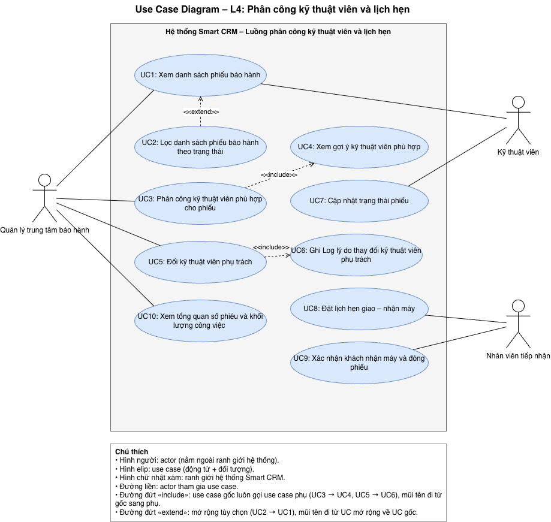
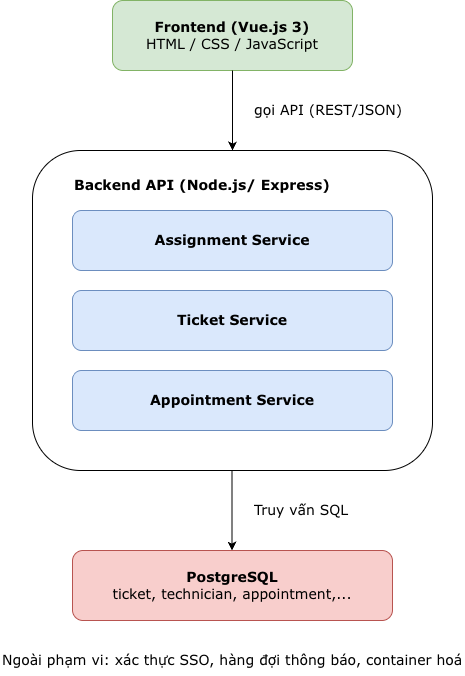
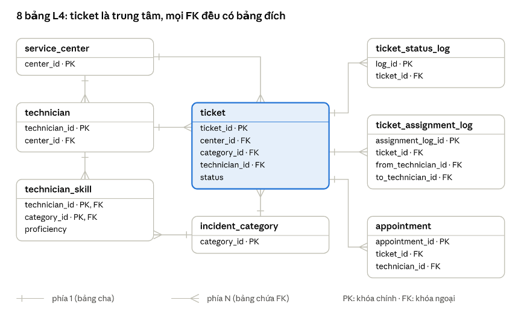
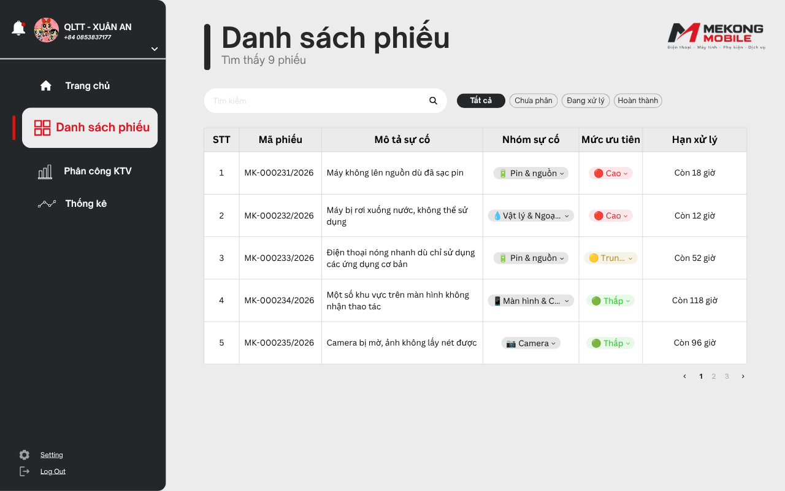
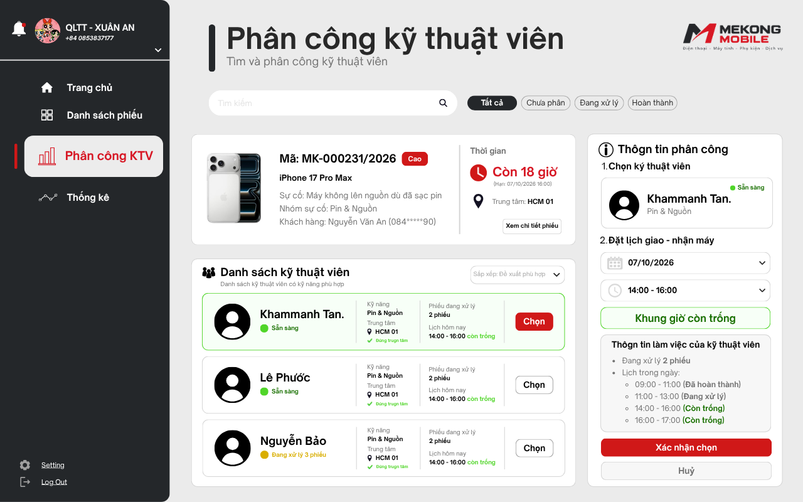
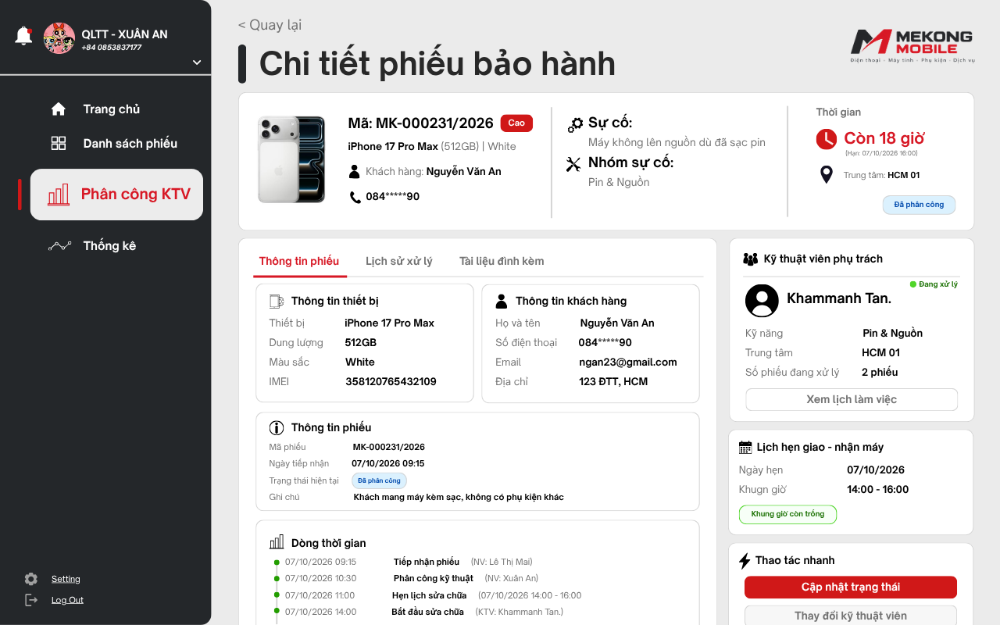

# BÁO CÁO BÀI TẬP 1

## MÔN CHUYÊN ĐỀ TỐT NGHIỆP 1

### Luồng 4: Phân công kỹ thuật viên và lịch hẹn (Track: SE)

**SVTH:** LUIBOUATHONG ANOPHONE

**MSSV:** 237480201IS01

**GVHD:** ThS. Nguyễn Minh Tân

# Chương 1: Tài liệu đặc tả yêu cầu (SRS)

## 1. Giới thiệu và phạm vi của doanh nghiệp

### 1.1. Bối cảnh doanh nghiệp

Công ty Cổ phần Bán lẻ và Dịch vụ Mekong Mobile hoạt động trong lĩnh vực bán lẻ điện thoại di động, máy tính bảng, phụ kiện và cung cấp dịch vụ bảo hành, sửa chữa. Công ty được thành lập năm 2015 và hiện tại đang có 24 cửa hàng bán lẻ tại TP.HCM, Cần Thơ và Hà Nội với 6 trung tâm bảo hành.

Công ty có khoảng 180 nhân viên gồm 38 kỹ thuật viên bảo hành và 12 nhân viên tiếp nhận. Mekong Mobile đã có khoảng 65.000 khách hàng đã mua hàng với dữ liệu đã ghi nhận rời rạc và chưa hợp nhất. Mỗi tháng công ty phát sinh trung bình khoảng 900 đơn hàng và 260 yêu cầu bảo hành.

Việc phân công kỹ thuật viên hiện chủ yếu thực hiện thủ công, phụ thuộc vào kinh nghiệm của quản lý trung tâm nên có thể gây mất cân đối khối lượng công việc. Ban giám đốc định hướng xây dựng Smart CRM trong 12 tháng nhằm hợp nhất dữ liệu khách hàng, số hóa quy trình bảo hành và hỗ trợ báo cáo điều hành. Do nguồn lực có hạn, hệ thống được triển khai theo từng luồng nghiệp vụ.

### 1.2. Luồng nghiệp vụ đã chọn

Phạm vi của đề tài sẽ tập trung vào việc “phân công kỹ thuật viên và lịch hẹn”. Luồng nghiệp vụ hỗ trợ việc quản lý trung tâm bảo hành xem danh sách phiếu chưa phân công và khối lượng công việc hiện tại của từng kỹ thuật viên phù hợp theo tay nghề và trung tâm. Đồng thời, kỹ thuật viên cần cập nhật trạng thái phiếu theo tốc độ xử lý, nhân viên tiếp nhận hẹn lịch hẹn giao – nhận máy với khách hàng và luồng sẽ kết thúc khi khách hàng nhận máy và phiếu sẽ được đóng.

### 1.3. Những chủ ý không cần làm (mức WON’T của MoSCoW)

- Không quản lý toàn bộ hệ thống Smart CRM của Mekong Mobile
- Không quản lý bán hàng và đơn hàng
- Không hiện thực chức năng tiếp nhận phiếu bảo hành ban đầu (thuộc luồng số 2)
- Không quản lý tồn kho linh kiện (thuộc luồng số 5)
- Không khảo sát hài lòng sau khi đóng phiếu (thuộc luồng số 8)
- Không tối ưu hoá thuật toán phân công (thuộc luồng 4)

### 1.4. Bảng thuật ngữ nghiệp vụ trong tài liệu

| STT | Thuật ngữ | Định nghĩa | Tên kỹ thuật |
|---|---|---|---|
| 1 | Phiếu bảo hành | Một yêu cầu bảo hành/ sửa chữa được ghi nhận gồm mã phiếu duy nhất và vòng đời trạng thái | ticket |
| 2 | Trạng thái phiếu | Vị trí hiện tại của phiếu trong vòng đời (Mới/ Đã phân công/ Đang xử lý/ Chờ linh kiện/ Hoàn tất/ Đã đóng) | ticket_status |
| 3 | Kỹ thuật viên | Nhân viên thực hiện sửa chữa, có danh sách tay nghề và địa bàn làm việc | technician |
| 4 | Tay nghề | Mức thành thạo của kỹ thuật viên theo từng nhóm sự cố | technician_skill |
| 5 | Lịch hẹn | Khung thời gian đã hẹn giữa khách hàng và kỹ thuật viên để giao – nhận thiết bị | appointment |
| 6 | Hạn cam kết (SLA) | Thời điểm chậm nhất phải hoàn tất phiếu, tính từ lúc tiếp nhận phiếu theo mức ưu tiên | due_date |

## 2. Các bên liên quan

| Vai trò | Nhiệm vụ | Hạn chế |
|---|---|---|
| Quản lý trung tâm bảo hành | - Xem danh sách phiếu chưa phân công - Xem khối lượng công việc của kỹ thuật viên - Phân công/ đổi kỹ thuật viên phù hợp (kèm lý do) - Xem tổng quan trung tâm | - Không thể xem được dữ liệu của trung tâm khác (QT-14) |
| Kỹ thuật viên | - Xem phiếu được phân công - Cập nhật trạng thái phiếu | - Không thể tự phân công phiếu (QT-08) |
| Nhân viên tiếp nhận | - Đặt lịch hẹn giao – nhận máy - Xác nhận khách nhận máy để đóng phiếu | - Không thể thay đổi phân công kỹ thuật viên |

## 3. Yêu cầu chức năng

| Mã | Yêu cầu chức năng | MoSCoW |
|---|---|---|
| FR1 | Hiển thị và lọc danh sách phiếu bảo hành theo trạng thái (Chưa phân công / Đang xử lý / Hoàn tất); kỹ thuật viên chỉ thấy phiếu của mình, sắp theo hạn cam kết | MUST |
| FR2 | Gợi ý kỹ thuật viên phù hợp cho một phiếu: tay nghề ≥ 3 theo nhóm sự cố của phiếu, cùng trung tâm, kèm số phiếu đang xử lý | MUST |
| FR3 | Phân công kỹ thuật viên đã chọn cho phiếu, chuyển trạng thái sang Đã phân công và ghi log | MUST |
| FR4 | Đổi kỹ thuật viên phụ trách một phiếu và bắt buộc nhập lý do thay đổi; ghi log | SHOULD |
| FR5 | Kỹ thuật viên cập nhật trạng thái phiếu đúng thứ tự vòng đời; hệ thống tự ghi lịch sử chuyển trạng thái | MUST |
| FR6 | Đặt lịch hẹn giao – nhận máy; cảnh báo nếu trùng lịch của kỹ thuật viên | SHOULD |
| FR7 | Xác nhận khách hàng đã đến nhận máy để đóng phiếu | SHOULD |
| FR8 | Hiển thị tổng quan trung tâm: số phiếu theo trạng thái và số phiếu đang xử lý của từng kỹ thuật viên | COULD |

## 4. User Story

| Mã | User Story | MoSCoW |
|---|---|---|
| US1 | Là quản lý trung tâm, tôi muốn xem danh sách phiếu bảo hành của trung tâm mình để biết phiếu nào cần phân công. | MUST |
| US2 | Là quản lý trung tâm, tôi muốn lọc danh sách phiếu bảo hành theo trạng thái để nhanh chóng tìm đúng nhóm phiếu cần theo dõi. | SHOULD |
| US3 | Là quản lý trung tâm, tôi muốn phân công kỹ thuật viên phù hợp tay nghề và còn khối lượng công việc để phân công cho phiếu bảo hành để chia đều công việc và sửa đúng chuyên môn. | MUST |
| US4 | Là quản lý trung tâm, tôi muốn xem gợi ý kỹ thuật viên dựa trên tay nghề, trung tâm và khối lượng công việc để lựa chọn người phù hợp cho phiếu. | MUST |
| US5 | Là quản lý trung tâm, tôi muốn đổi kỹ thuật viên phụ trách và ghi rõ lý do để có căn cứ tra soát khi cần. | SHOULD |
| US6 | Là quản lý trung tâm, tôi muốn hệ thống lưu lịch sử thay đổi phân công cùng lý do để có thể tra soát khi cần. | SHOULD |
| US7 | Là kỹ thuật viên, tôi muốn xem các phiếu bảo hành được phân công sắp theo hạn cam kết để ưu tiên xử lý đúng thời hạn. | SHOULD |
| US8 | Là kỹ thuật viên, tôi muốn cập nhật trạng thái phiếu bảo hành để quản lý trung tâm biết tiến độ xử lý. | MUST |
| US9 | Là nhân viên tiếp nhận, tôi muốn đặt lịch hẹn giao – nhận máy để khách hàng biết thời điểm đến cửa hàng nhận máy. | SHOULD |
| US10 | Là nhân viên tiếp nhận, tôi muốn được cảnh báo khi lịch hẹn bị trùng để tránh hẹn hai khách cùng một thời điểm. | SHOULD |
| US11 | Là nhân viên tiếp nhận, tôi muốn xác nhận khách hàng đã nhận máy để đóng phiếu bảo hành và kết thúc quy trình bảo hành. | SHOULD |
| US12 | Là quản lý trung tâm, tôi muốn xem tổng quan số phiếu theo trạng thái và khối lượng của từng kỹ thuật viên để theo dõi số thống kê mỗi tháng. | COULD |

## 5. Yêu cầu phi chức năng

| Mã | Yêu cầu (có ngưỡng đo được) | Nhóm |
|---|---|---|
| NFR1 | Danh sách phiếu bảo hành của một trung tâm (tối đa 500 phiếu) hiển thị trong ≤ 2 giây ở phân vị 95 | Hiệu năng |
| NFR2 | Gợi ý kỹ thuật viên cho một phiếu trả kết quả trong ≤ 3 giây với tối đa 38 kỹ thuật viên | Hiệu năng |
| NFR3 | 100% yêu cầu truy cập dữ liệu của trung tâm khác bị từ chối (QT-14); 100% yêu cầu kỹ thuật viên tự phân công bị từ chối (quy định phân quyền vai trò) | Bảo mật |
| NFR4 | 100% thao tác phân công, đổi kỹ thuật viên, chuyển trạng thái được ghi log (người thực hiện, thời điểm), lưu ≥ 12 tháng | Truy vết |
| NFR5 | Hệ thống sẵn sàng ≥ 99% trong giờ làm việc 08:00 – 20:00 mỗi tháng | Khả dụng |

## 6. Ràng buộc và quy tắc nghiệp vụ

| Mã | Quy tắc nghiệp vụ | Luồng liên quan |
|---|---|---|
| QT-03 | Thiết bị được xác định duy nhất bằng số Serial hoặc IMEI. Một thiết bị chỉ thuộc về một khách hàng tại một thời điểm. | L2, L4 |
| QT-04 | Hạn cam kết được sinh tự động từ thời điểm tiếp nhận theo độ ưu tiên: CAO = 24 tiếng, TRUNG_BINH = 72 tiếng và THAP = 120 tiếng (Tính theo ngày làm việc từ thứ Hai đến thứ Bảy) | L2, L4 |
| QT-06 | Phiếu chỉ được chuyển trạng thái theo đúng vòng đời, không được quay lại trạng thái trước. Mọi lần chuyển trạng thái đều phải ghi vào ticket_status_log | L2,L4,L5 |
| QT-07 | Một phiếu tại một thời điểm chỉ được gán cho tối đa một kỹ thuật viên. Việc đổi kỹ thuật viên phải được ghi lại kèm lý do. | L4 |
| QT-08 | Kỹ thuật viên chỉ được phân công phiếu thuộc nhóm sự cố mà mình có tay nghề (Proficiency ≥ 3) và cùng trung tâm. | L4 |
| QT-13 | Không được xoá vật lý phiếu bảo hành, đơn hàng hay hồ sơ của khách hàng. Chỉ đánh dấu ngừng sử dụng (Soft delete) và giữ nguyên lịch sử. | Tất cả |
| QT-14 | - Nhân viên chỉ xem được dữ liệu của trung tâm hoặc cửa hàng mình đang làm việc - Quản lý xem được toàn bộ đơn vị mình phụ trách. - Ban giám đốc xem được toàn công ty | Tất cả |
| QT-15 | Số điện thoại khách hàng hiển thị dạng che (ví dụ: 085*****77) với mọi vai trò trừ Quản lý và Ban giám đốc. | Tất cả |

## 7. Bảng truy vết yêu cầu

| FR | User Story | Use Case | MoSCoW |
|---|---|---|---|
| FR1 | US1, US2, US7 | UC1, UC2 | MUST |
| FR2 | US4 | UC4 | MUST |
| FR3 | US3 | UC3 | MUST |
| FR4 | US5, US6 | UC5, UC6 | SHOULD |
| FR5 | US8 | UC7 | MUST |
| FR6 | US9, US10 | UC8 | SHOULD |
| FR7 | US11 | UC9 | SHOULD |
| FR8 | US12 | UC10 | COULD |

# Chương 2: Use Case Diagram

## 1. Danh sách Use Case

| Mã Use Case | Tên Use Case | Actor | User Story liên quan |
|---|---|---|---|
| UC1 | Xem danh sách phiếu bảo hành | Quản lý trung tâm, Kỹ thuật viên | US1, US7 |
| UC2 | Lọc danh sách phiếu theo trạng thái | Quản lý trung tâm | US2 |
| UC3 | Phân công kỹ thuật viên cho phiếu | Quản lý trung tâm | US3 |
| UC4 | Xem gợi ý kỹ thuật viên phù hợp | Quản lý trung tâm | US4 |
| UC5 | Đổi kỹ thuật viên phụ trách và ghi lý do | Quản lý trung tâm | US5, US6 |
| UC6 | Ghi log lý do thay đổi phân công | UC5 gọi (không có actor riêng) | US6 |
| UC7 | Cập nhật trạng thái phiếu | Kỹ thuật viên | US8 |
| UC8 | Đặt lịch hẹn giao – nhận máy và cảnh báo trùng | Nhân viên tiếp nhận | US9, US10 |
| UC9 | Xác nhận khách nhận máy và đóng phiếu | Nhân viên tiếp nhận | US11 |
| UC10 | Xem tổng quan trung tâm | Quản lý trung tâm | US12 |

## 2. Sơ đồ Use Case Diagram

File ảnh: `docs/use-case-diagram.png`. File nguồn chỉnh sửa: `docs/use-case-diagram.drawio`.

## 3. Đặc tả chi tiết Use Case quan trọng

### UC3: Phân công kỹ thuật viên phù hợp cho phiếu

- **Actor chính:** Quản lý trung tâm bảo hành
- **Mục tiêu:** Gán một kỹ thuật viên phù hợp cho phiếu để bắt đầu xử lý
- **Điều kiện trước:** Phiếu đang ở trạng thái Mới, chưa được phân công
- **Điều kiện sau:** Phiếu chuyển sang trạng thái Đã phân công, gắn với đúng một kỹ thuật viên, có ghi log

### 3.1. Luồng chính

1. Quản lý chọn một phiếu trong danh sách chưa phân công (từ UC1).
2. Hệ thống hiển thị chi tiết phiếu: mã phiếu, thiết bị, nhóm sự cố, hạn cam kết.
3. Quản lý yêu cầu xem gợi ý kỹ thuật viên (include UC4).
4. Hệ thống lọc kỹ thuật viên cùng trung tâm có tay nghề ≥ 3 theo nhóm sự cố, hiển thị kèm số phiếu đang xử lý, ít phiếu nhất lên đầu.
5. Quản lý chọn một kỹ thuật viên.
6. Quản lý xác nhận phân công.
7. Hệ thống kiểm tra phiếu vẫn ở trạng thái Mới.
8. Hệ thống gán kỹ thuật viên, chuyển phiếu sang Đã phân công và ghi log.
9. Hệ thống thông báo thành công và loại phiếu khỏi danh sách chưa phân công.

### 3.2. Luồng ngoại lệ (đánh số theo bước)

1. Phiếu thuộc trung tâm khác (QT-14): hệ thống từ chối truy cập, use case kết thúc.
2. Không có kỹ thuật viên đạt tay nghề ≥ 3 cùng trung tâm: hệ thống hiển thị "Không có kỹ thuật viên phù hợp", không cho xác nhận; use case kết thúc, phiếu giữ nguyên trạng thái Mới.
3. Quản lý hủy phiếu phân công: hệ thống quay về danh sách, không thay đổi dữ liệu.
4. Phiếu đã bị người khác phân công hoặc đổi trạng thái: hệ thống báo xung đột, tải lại danh sách, không ghi thay đổi.
5. Lỗi hệ thống khi lưu: hệ thống hoàn tác toàn bộ, phiếu giữ trạng thái Mới và báo lỗi cho quản lý.

# Chương 3: Thiết kế kiến trúc

## 1. Sơ đồ kiến trúc

File gốc: `docs/architecture.png`.

## 2. Những câu lập luận kiến trúc

### 1)

**NFR1 – Hiệu năng:** Để đáp ứng mục tiêu hiển thị tối đa 500 phiếu trong ≤ 2 giây ở phân vị 95, kiến trúc ưu tiên truy vấn có điều kiện lọc theo trung tâm và trạng thái; chỉ bổ sung chỉ mục hoặc phân trang khi được xác nhận trong mã nguồn và kiểm thử. Đánh đổi là cần thiết kế truy vấn và đo hiệu năng với dữ liệu đủ lớn.

### 2)

**NFR2 – Hiệu năng:** Chức năng gợi ý kỹ thuật viên cần trả kết quả trong ≤ 3 giây với tối đa 38 kỹ thuật viên. Thiết kế ưu tiên lọc theo trung tâm, nhóm sự cố và mức tay nghề trước khi sắp xếp theo khối lượng công việc. Đánh đổi là truy vấn cần kết hợp dữ liệu kỹ thuật viên, kỹ năng và phiếu đang xử lý.

### 3)

**NFR3 – Bảo mật:** Quyền truy cập phải được kiểm tra tại API theo vai trò và phạm vi trung tâm, không chỉ ở giao diện. Đánh đổi là tăng logic kiểm tra quyền ở các endpoint. Đây là yêu cầu thiết kế; mức độ hiện thực cần được đối chiếu với mã nguồn và kiểm thử.

### 4)

**NFR4 – Truy vết:** Phân công, đổi kỹ thuật viên và chuyển trạng thái cần ghi lịch sử gồm người thực hiện và thời điểm, với thời gian lưu tối thiểu 12 tháng. Thiết kế cần bảo đảm dữ liệu nghiệp vụ và nhật ký nhất quán; việc đã dùng transaction hay chưa phải kiểm tra từ mã nguồn.

# Chương 4: Mô hình dữ liệu (ERD, track SE)

## 1. ERD là gì

ERD mô tả các bảng dữ liệu và quan hệ giữa chúng bằng khóa chính (PK), khóa ngoại (FK). Sơ đồ dưới đây thể hiện các bảng liên quan đến luồng L4; các quan hệ và cột cần được đối chiếu với SQL DDL của dự án.

Dưới đây là 8 bảng thể hiện trên sơ đồ ERD hiện tại:

| Bảng | Khoá chính (PK) | Khoá ngoại (FK) |
|---|---|---|
| service_center | center_id | — |
| incident_category | category_id | — |
| ticket | ticket_id | technician_id → technician, center_id → service_center, category_id → incident_category |
| technician | technician_id | center_id → service_center |
| technician_skill | (technician_id, category_id) | technician_id → technician, category_id → incident_category |
| appointment | appointment_id | ticket_id → ticket, technician_id → technician |
| ticket_status_log | log_id | ticket_id → ticket |
| ticket_assignment_log | assignment_log_id | ticket_id → ticket, from_technician_id → technician, to_technician_id → technician |

## 2. Mô hình SQL DDL

Sơ đồ ERD trình bày rút gọn 8 bảng thuộc luồng L4, tập trung vào khóa chính (PK) và các quan hệ khóa ngoại (FK) tiêu biểu. Tên bảng, khóa chính và khóa ngoại đã được đối chiếu với các file migration SQL (001–003). Các cột chi tiết và ràng buộc bổ sung, bao gồm is_active của bảng appointment, được định nghĩa trong SQL DDL.

File gốc: `docs/erd.png`.

# Chương 5: Thiết kế Wireframe

## 1. Màn hình Wireframe

### 1) Màn hình 1. Danh sách phiếu

File gốc: `docs/wireframe1.png`.

### 2) Màn hình 2. Phân công kỹ thuật viên

File gốc: `docs/wireframe2.png`.

### 3) Màn hình 3. Chi tiết phiếu/ lịch hẹn

File gốc: `docs/wireframe3.png`.
